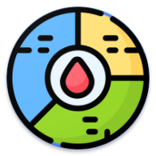
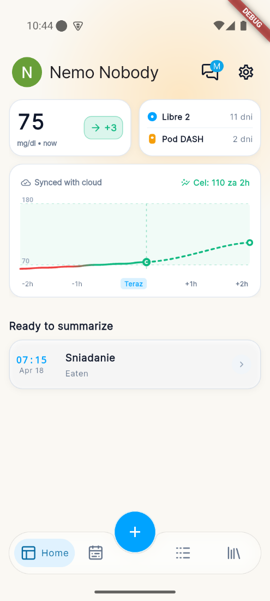
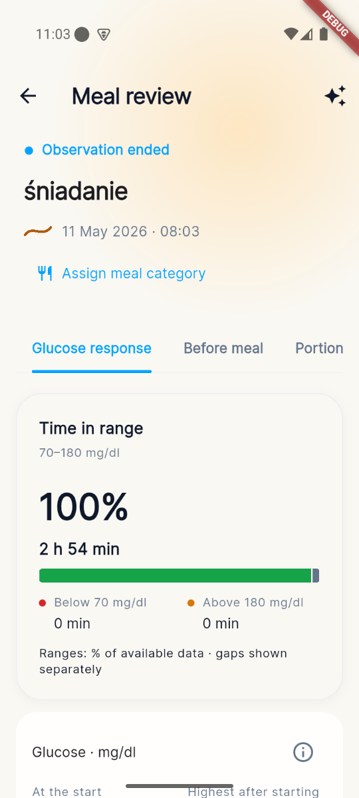
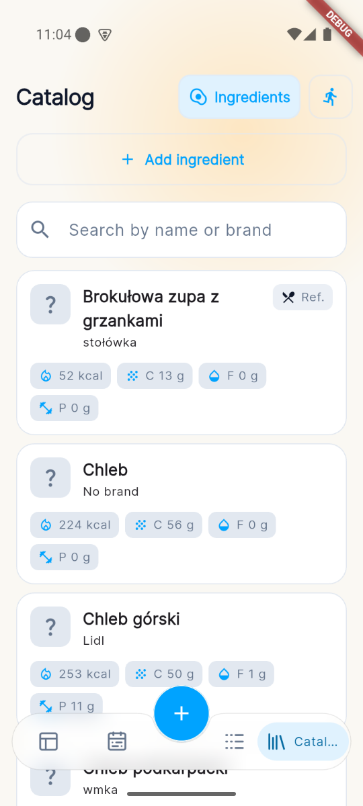
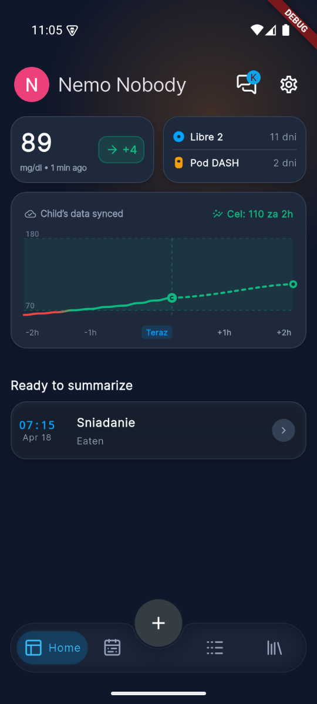
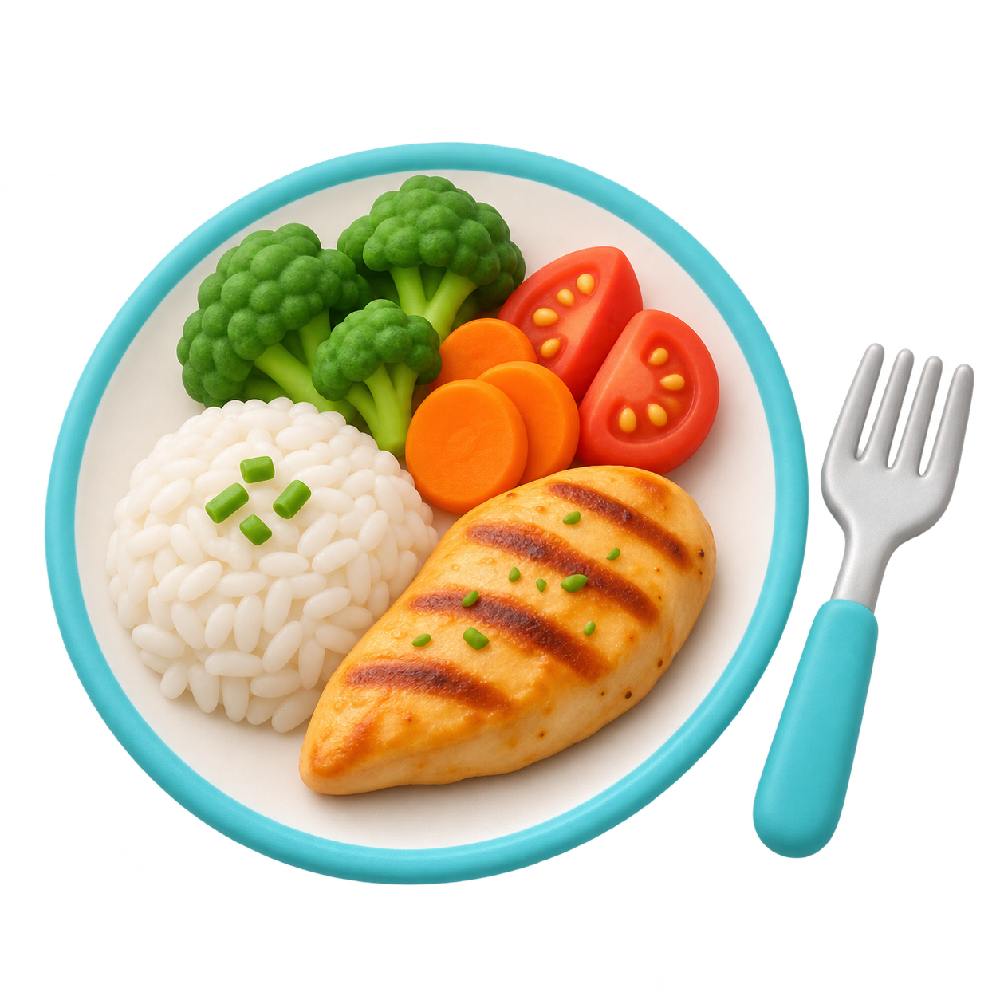
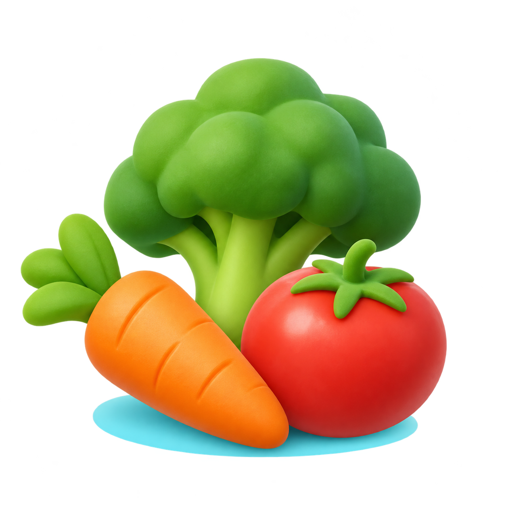

<p align="right"><strong>EN</strong> | <a href="README.pl.md">PL</a></p>

<div align="center">
  
  <h1>DiaBeatThis</h1>
  <p><strong>Less to remember. More room for everyday life.</strong></p>
  <p>Meals, glucose, activity and family support — together in one app for people living with type 1 diabetes.</p>
  <p>
    <a href="https://github.com/njmo/diabeatthis/releases">Get the Android app</a> ·
    <a href="docs/wiki/Home.md">User guides (PL)</a> ·
    <a href="https://github.com/njmo/diabeatthis/issues">Share an idea or report a bug</a>
  </p>
</div>

## A school sandwich can be a whole plan

What's in the lunchbox? How much did your child eat? Was there a bolus? And PE starts in an hour…

DiaBeatThis is built for days like these. It helps you prepare food, follow a meal with reminders, and look back at what happened to glucose afterwards. It also makes room for changes: an extra helping, food left on the plate, or fast carbs needed during a workout.

**DiaBeatThis focuses on food and the context of your day. Insulin calculations, confirmation and delivery remain with AAPS and the user.**

## Take a look inside

<table>
  <tr>
    <td align="center" width="50%"><br /><strong>The essentials at a glance</strong></td>
    <td align="center" width="50%"><br /><strong>What happened after the meal?</strong></td>
  </tr>
  <tr>
    <td align="center"><br /><strong>Your own ingredient collection</strong></td>
    <td align="center"><br /><strong>A caregiver's view · dark mode</strong></td>
  </tr>
</table>

Screenshots from local development builds on the child and caregiver emulators. They show the interface, not treatment instructions or proof that integrations work. The DEBUG ribbon and mixed-language labels reflect the builds used.

[See the meal history screen too](docs/assets/screenshots/meal-history.png).

## What's already here

###  From the plan to the last bite

Plan a meal with ingredients, weights and nutrition information. Use your own portions — a slice, a piece or a school serving — and reuse saved meals instead of entering everything again.

The meal monitor reminds you about the next steps: a temporary target, bolus, starting to eat and the meal summary. It also supports waiting after a bolus and responds to glucose trends. Opening the calculator alone is not treated as proof that insulin was delivered: meal status takes received treatment events into account.

Extra helpings and leftovers have a place in the summary, so the history can reflect what was actually eaten, rather than just the original plan.

### 📊 History worth coming back to

Meal analysis brings glucose together with available boluses, carbs, temporary targets, activities and low treatments. Reference meals help you plan the next breakfast or a similar lunch using earlier entries.

The day view collects the glucose chart, time in range, insulin data, meals and activities. It also shows how current and complete the data is. The basic summary works without AI analysis.

### 🚲 Activity and low treatments belong in the plan too

Plan PE, a workout or a walk. The activity monitor reminds you about a temporary target and asks whether the activity has ended. Low treatments can be linked to a meal or activity, making it easier to understand the day afterwards.

### 👨‍👩‍👧 Separate views for the child and caregiver

The code already includes Google sign-in, family pairing through a QR invitation and access approval, and synchronization of the child's shared data. Caregivers have their own dashboard for browsing the day, history and catalogs, and preparing meal and activity plans.

A caregiver's plan reaches the child's app through synchronization. This does not let the caregiver change a meal's execution state or deliver insulin remotely. These features require accounts, a configured Firebase backend and a network connection.

The code also supports remote meal consultations: the child sends a request, a caregiver reviews the context and replies, and the child can accept that reply in their meal workflow. This requires configuration on both sides and the appropriate backend; check the release notes for availability. A caregiver's reply does not itself deliver insulin.

The project is actively developed. Separate screens marked **Preview / demo**, including the conversation preview and demonstration meal consultation scenarios, showcase the interface. They do not confirm that communication between phones is working.

###  Ingredients within reach

Your own catalog keeps ingredients, nutrition information and portions ready to reuse in future meals. Products can be searched for and scanned by barcode.

### 📷 Less typing with AI

AI features help read nutrition labels, recognize food in photos, and analyze meals and days. You can check and correct the results before using them.

AI is optional and requires a provider configured for the feature you want. A photo does not replace weighing food or checking nutrition values. See the [AI guide (PL)](docs/wiki/AI.md) for details.

## Start with one meal

1. Download the APK from the [project releases](https://github.com/njmo/diabeatthis/releases), if one is attached to the release you choose.
2. Complete setup and select a data source. You can use **Nightscout** or an optional local connection to **AAPS**.
3. Check that glucose data is current, allow notifications and configure background operation.
4. Add your first meal and record what was actually eaten afterwards.

The local AAPS connection requires a version that supports broadcasting data to external apps. Instructions, the integration branch and screenshots of the settings are in the [AAPS integration guide (PL)](docs/wiki/AAPS-integration.md).

## Where to find the details

The linked user guides are currently in Polish.

| Want to… | Start here |
| --- | --- |
| Install and set up the app | [Installation](docs/wiki/Installation.md) · [First setup](docs/wiki/First-setup.md) |
| Plan food and revisit earlier meals | [Meals](docs/wiki/Meals.md) · [Ingredients and portions](docs/wiki/Ingredients.md) |
| Record exercise or low treatments | [Activity](docs/wiki/Activity.md) · [Low treatments](docs/wiki/Low-treatments.md) |
| Review a whole day's data | [Day overview](docs/wiki/Day-overview.md) |
| Enable AI features or troubleshoot | [AI](docs/wiki/AI.md) · [Troubleshooting](docs/wiki/Troubleshooting.md) |

The guides are updated independently of the code; some descriptions of family mode still refer to an earlier demonstration stage.

## Want to help build DiaBeatThis?

Code improvements and feedback from everyday life with T1D are both welcome. If something takes too many taps, a reminder is unclear, or an important scenario is missing, [tell us in an issue](https://github.com/njmo/diabeatthis/issues). For bugs, include the app version and the steps that led to the problem.

The app is built with **Flutter and Dart**. Android is the main user platform; family integrations and the ingredient catalog use a Firebase backend.

For local development, you need Flutter **3.47+**, Dart **3.12+** and an Android development environment:

```sh
flutter pub get
flutter gen-l10n
dart run build_runner build --delete-conflicting-outputs
flutter run
```

Google/Firebase features require configuration for your environment; running Flutter alone does not start the backend. More details: [family backend](backend/family/README.md), [ingredient catalog](backend/ingredient_catalog/README.md) and [Android release preparation (PL)](docs/google_play_release.md).

## Using the app

DiaBeatThis supports daily routines and data review. It does not replace medical advice or make autonomous insulin decisions. Therapy decisions remain with the user, caregiver and medical team.

## License

DiaBeatThis is available under the custom **DiaBeatThis Community License 1.0**. It is a *source-available* project with restrictions on monetizing the software. Read the full terms in [LICENSE.txt](LICENSE.txt).

- **You may** use the app for free, study and modify the code, and share versions under the license terms, providing recipients with the corresponding source code.
- **Healthcare professionals and organizations may** use the app in patient care, including paid consultations. This does not permit selling the app or charging for access to it.
- **Selling the app, paid hosting, subscriptions, advertising and other forms of monetization specified in the license require prior written permission from the relevant copyright holders**, including for derivative versions.

The software is provided without warranty to the extent permitted by law. Third-party libraries and assets retain their own licenses and attribution notices, including the [food icons](assets/icons/food/LICENSE.txt).
