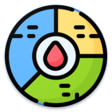
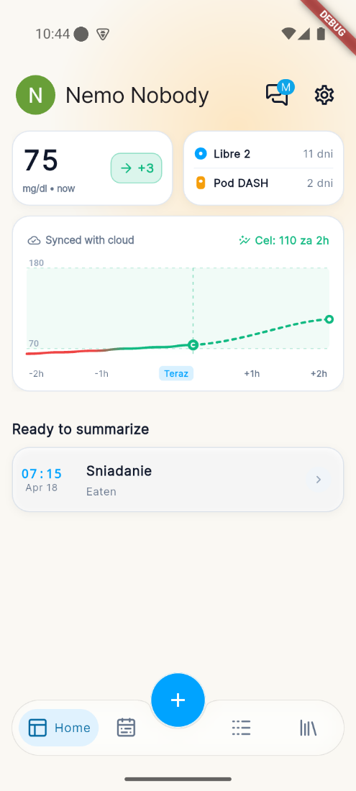
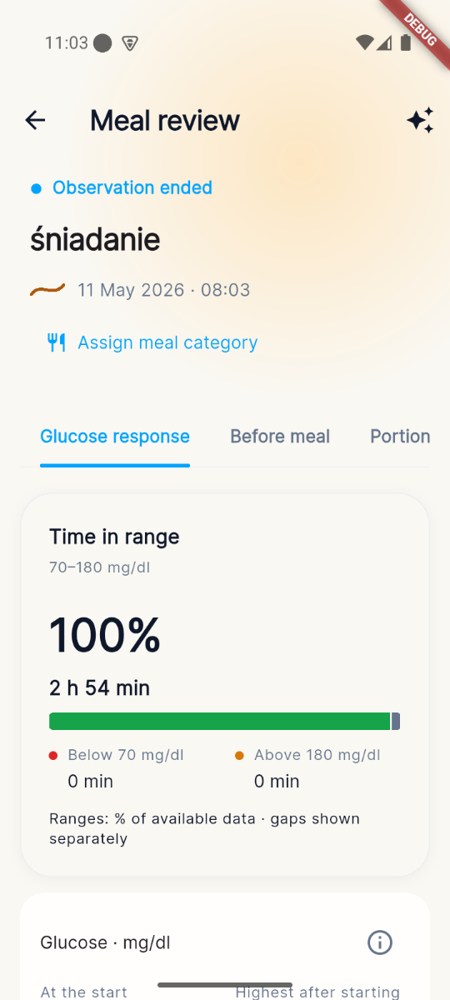
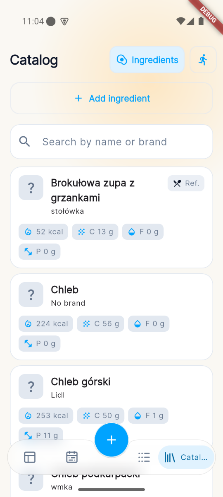
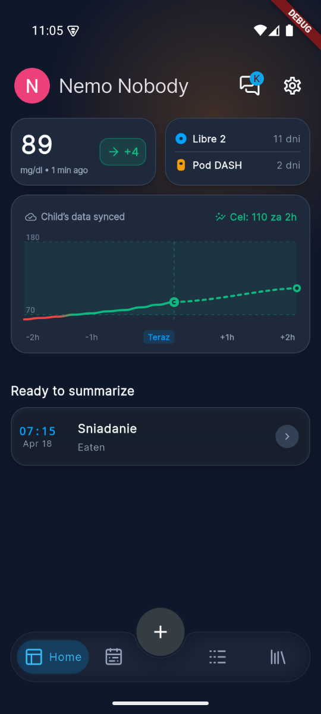
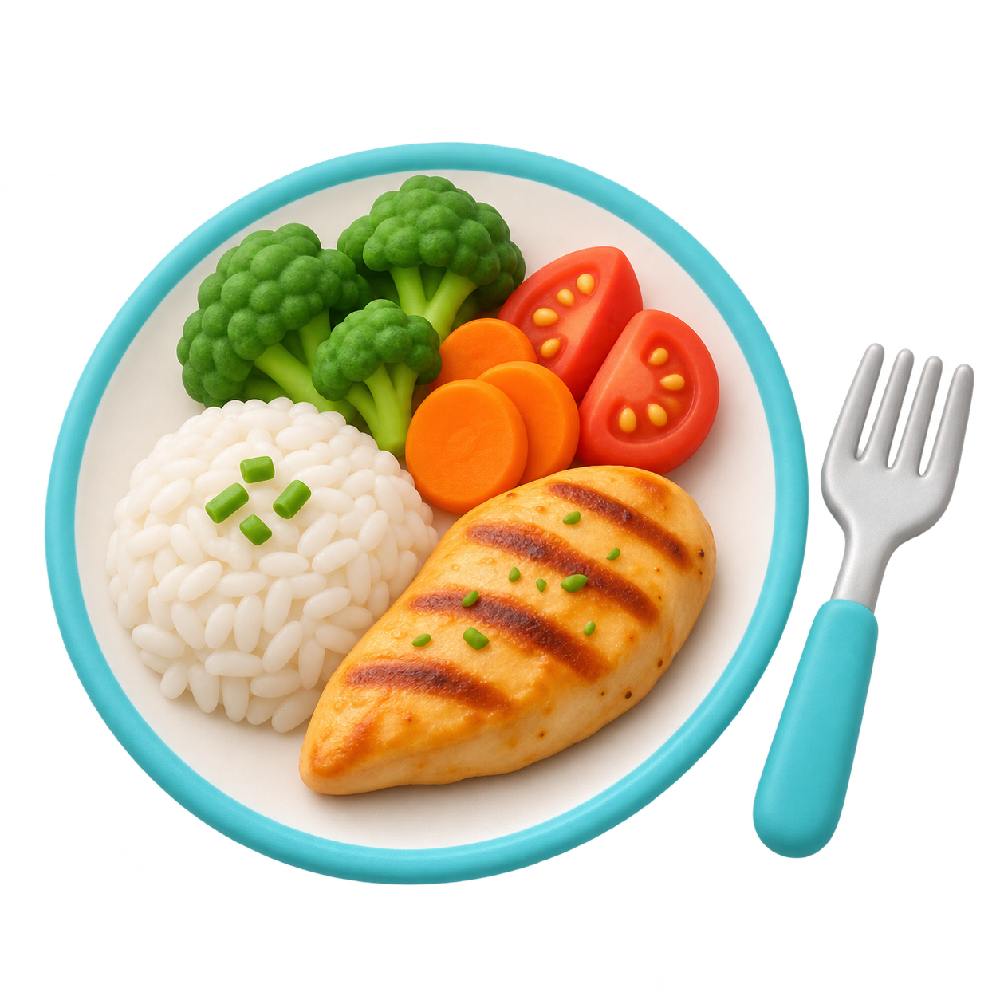
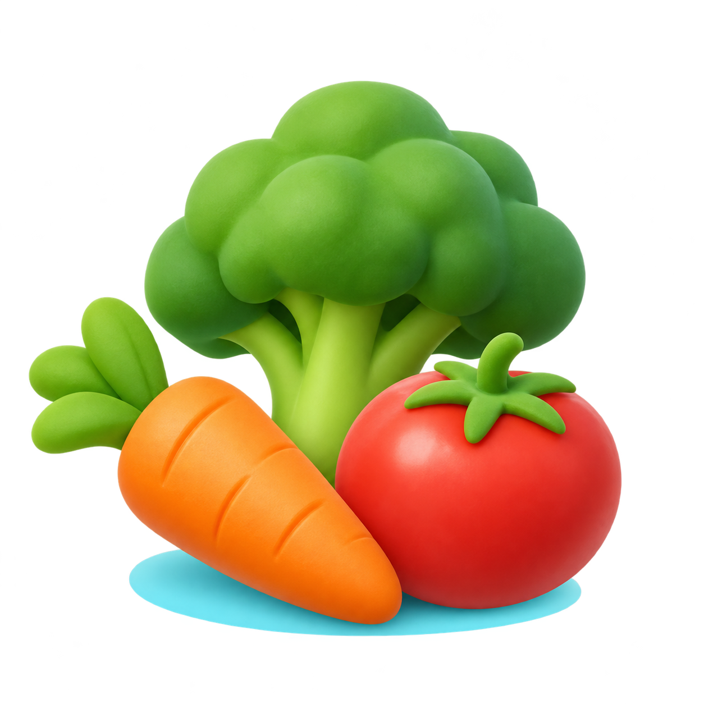

<p align="right"><a href="README.md">EN</a> | <strong>PL</strong></p>

<div align="center">
  
  <h1>DiaBeatThis</h1>
  <p><strong>Mniej rzeczy do pamiętania. Więcej miejsca na zwykły dzień.</strong></p>
  <p>Posiłki, glikemia, aktywność i wsparcie rodziny — w jednej aplikacji dla osób z cukrzycą typu 1.</p>
  <p>
    <a href="https://github.com/njmo/diabeatthis/releases">Pobierz na Androida</a> ·
    <a href="docs/wiki/Home.md">Poradniki</a> ·
    <a href="https://github.com/njmo/diabeatthis/issues">Zgłoś pomysł lub błąd</a>
  </p>
</div>

## Kanapka do szkoły to czasem cały plan

Co jest w pudełku? Ile dziecko zjadło? Czy był bolus? A za godzinę WF…

DiaBeatThis powstaje z myślą o takich właśnie dniach. Pomaga przygotować jedzenie, przejść przez posiłek z przypomnieniami i później zobaczyć, co działo się z glukozą. Sprawdza się też wtedy, gdy plan się zmienia: jest dokładka, coś zostaje na talerzu albo podczas treningu potrzeba dosładzania.

**DiaBeatThis zajmuje się jedzeniem i kontekstem dnia. Obliczanie, zatwierdzanie i podawanie insuliny pozostaje w AAPS i po stronie użytkownika.**

## Zajrzyj do aplikacji

<table>
  <tr>
    <td align="center" width="50%"><br /><strong>Najważniejsze rzeczy pod ręką</strong></td>
    <td align="center" width="50%"><br /><strong>Co działo się po posiłku?</strong></td>
  </tr>
  <tr>
    <td align="center"><br /><strong>Własna baza składników</strong></td>
    <td align="center"><br /><strong>Podgląd u opiekuna · ciemny motyw</strong></td>
  </tr>
</table>

Zrzuty z lokalnych wersji deweloperskich na emulatorach dziecka i opiekuna. Pokazują wygląd interfejsu; nie są instrukcją postępowania ani potwierdzeniem działania integracji. Widoczna wstęga DEBUG i język części etykiet wynikają z używanych wersji aplikacji.

[Zobacz także historię posiłków](docs/assets/screenshots/meal-history.png).

## Co już jest

###  Od planu do ostatniego kęsa

Zaplanuj posiłek ze składnikami, gramaturą i wartościami odżywczymi. Korzystaj z własnych porcji — kromki, sztuki czy porcji szkolnej — i wracaj do zapisanych posiłków zamiast wpisywać wszystko od początku.

Monitor posiłku przypomina o kolejnych krokach: celu tymczasowym, bolusie, rozpoczęciu jedzenia i podsumowaniu. Obsługuje również czekanie po bolusie i reaguje na trend glukozy. Samo otwarcie kalkulatora nie oznacza dla aplikacji, że insulina została podana: stan posiłku uwzględnia odebrane zdarzenia leczenia.

Dokładki i niezjedzona część mają swoje miejsce w podsumowaniu, więc historia może opisywać rzeczywisty posiłek, a nie tylko pierwotny plan.

### 📊 Historia, do której warto wracać

Analiza posiłku zestawia glikemię z dostępnymi bolusami, węglowodanami, celami tymczasowymi, aktywnościami i dosładzaniem. Posiłki referencyjne pomagają przygotować kolejne śniadanie czy podobny obiad na podstawie wcześniejszych wpisów.

Widok dnia zbiera wykres glukozy, czas w zakresie, dane o insulinie, posiłki i aktywności. Pokazuje też aktualność i kompletność danych. Podstawowe podsumowanie działa bez analizy AI.

### 🚲 Ruch i dosładzanie też należą do planu

Zaplanuj WF, trening albo spacer. Monitor aktywności przypomni o celu tymczasowym i zapyta o zakończenie aktywności. Dosładzanie można powiązać z posiłkiem lub ruchem, żeby później łatwiej zrozumieć przebieg dnia.

### 👨‍👩‍👧 Dziecko i opiekun mają swoje widoki

W kodzie są już logowanie Google, parowanie rodziny przez zaproszenie QR i zatwierdzenie dostępu, a także synchronizacja udostępnionych danych dziecka. Opiekun ma osobny panel do przeglądania dnia, historii i katalogów oraz przygotowywania planów posiłków i aktywności.

Plan od opiekuna trafia do aplikacji dziecka przez synchronizację. Opiekun nie zmienia w ten sposób stanu wykonania posiłku ani nie podaje zdalnie insuliny. Ta część wymaga kont, skonfigurowanego backendu Firebase i połączenia z siecią.

Kod obsługuje również zdalną konsultację posiłku: dziecko wysyła prośbę, opiekun przegląda kontekst i odpowiada, a dziecko może przyjąć odpowiedź w swoim przepływie posiłku. Funkcja wymaga konfiguracji po obu stronach i odpowiedniego backendu; jej dostępność sprawdzaj w opisie wydania. Odpowiedź opiekuna sama nie podaje insuliny.

Projekt jest aktywnie rozwijany. Osobne ekrany oznaczone jako **Podgląd / demo**, w tym podgląd rozmów i demonstracyjne scenariusze konsultacji posiłku, służą do prezentacji interfejsu. Nie potwierdzają działania komunikacji między telefonami.

###  Składniki pod ręką

Własny katalog zbiera składniki, wartości odżywcze i porcje, do których można wracać przy kolejnych posiłkach. Produkty można wyszukiwać i skanować po kodzie kreskowym.

### 📷 Mniej przepisywania dzięki AI

Funkcje AI pomagają odczytywać etykiety, rozpoznawać jedzenie ze zdjęć oraz analizować posiłki i dzień. Wynik można sprawdzić i poprawić przed użyciem.

AI jest opcjonalne i wymaga konfiguracji dostawcy odpowiedniego dla danej funkcji. Zdjęcie nie zastępuje ważenia ani sprawdzenia wartości odżywczych. Szczegóły znajdziesz w [poradniku AI](docs/wiki/AI.md).

## Zacznij od jednego posiłku

1. Pobierz APK z [wydań projektu](https://github.com/njmo/diabeatthis/releases), jeśli jest dołączone do wybranego wydania.
2. Przejdź przez konfigurację i wybierz źródło danych. Możesz korzystać z **Nightscout** lub opcjonalnego lokalnego połączenia z **AAPS**.
3. Sprawdź aktualność glikemii, zezwól na powiadomienia i skonfiguruj działanie w tle.
4. Dodaj pierwszy posiłek, a po jedzeniu uzupełnij to, co rzeczywiście zostało zjedzone.

Lokalne połączenie z AAPS wymaga wersji obsługującej rozgłaszanie danych do aplikacji zewnętrznych. Instrukcję, gałąź ze zmianą i zrzuty ustawień znajdziesz w [poradniku integracji AAPS](docs/wiki/AAPS-integration.md).

## Gdzie szukać szczegółów

| Chcesz… | Zajrzyj tutaj |
| --- | --- |
| Zainstalować i skonfigurować aplikację | [Instalacja](docs/wiki/Installation.md) · [Pierwsze uruchomienie](docs/wiki/First-setup.md) |
| Zaplanować jedzenie i wrócić do historii | [Posiłki](docs/wiki/Meals.md) · [Składniki i porcje](docs/wiki/Ingredients.md) |
| Zapisać trening lub dosładzanie | [Aktywność](docs/wiki/Activity.md) · [Dosładzanie](docs/wiki/Low-treatments.md) |
| Przejrzeć dane z całego dnia | [Podsumowanie dnia](docs/wiki/Day-overview.md) |
| Włączyć funkcje AI lub rozwiązać problem | [AI](docs/wiki/AI.md) · [Rozwiązywanie problemów](docs/wiki/Troubleshooting.md) |

Poradniki są aktualizowane niezależnie od kodu; niektóre opisy trybu rodzinnego nadal odnoszą się do wcześniejszego etapu demonstracyjnego.

## Chcesz pomóc rozwijać DiaBeatThis?

Przydają się zarówno poprawki kodu, jak i uwagi z codziennego życia z T1D. Jeśli coś wymaga zbyt wielu kliknięć, przypomnienie jest niejasne albo brakuje ważnego scenariusza — [opisz to w zgłoszeniu](https://github.com/njmo/diabeatthis/issues). Przy błędzie podaj wersję aplikacji i kroki, które do niego prowadzą.

Aplikacja powstaje we **Flutterze i Darcie**. Główną platformą użytkową jest Android; integracje rodzinne i katalog składników mają backend Firebase.

Do pracy lokalnej potrzebujesz Fluttera **3.47+**, Darta **3.12+** oraz środowiska Android:

```sh
flutter pub get
flutter gen-l10n
dart run build_runner build --delete-conflicting-outputs
flutter run
```

Funkcje Google/Firebase wymagają konfiguracji dla używanego środowiska; samo uruchomienie Fluttera nie uruchamia backendu. Więcej o tych częściach: [backend rodzinny](backend/family/README.md), [katalog składników](backend/ingredient_catalog/README.md) i [przygotowanie wydania Android](docs/google_play_release.md).

## Ważne przy korzystaniu

DiaBeatThis wspiera organizację dnia i przeglądanie danych. Nie zastępuje porady medycznej ani nie podejmuje autonomicznych decyzji o insulinie. Decyzje dotyczące terapii należą do użytkownika, opiekuna i zespołu medycznego.

## Licencja

DiaBeatThis jest udostępniany na własnej licencji **DiaBeatThis Community License 1.0**. To projekt z dostępnym kodem (*source available*), z ograniczeniem zarabiania na oprogramowaniu. Pełne warunki znajdują się w [LICENSE.txt](LICENSE.txt).

- **Możesz** bezpłatnie korzystać z aplikacji, poznawać kod, modyfikować go i dzielić się wersjami na warunkach tej licencji, udostępniając odbiorcom odpowiadający im kod źródłowy.
- **Lekarze i placówki mogą** używać aplikacji podczas opieki nad pacjentami, również przy odpłatnych konsultacjach. Nie uprawnia to do sprzedaży aplikacji ani płatnego dostępu do niej.
- **Sprzedaż aplikacji, płatny hosting, abonamenty, reklamy i inne wskazane w licencji formy zarabiania na niej lub jej wersjach pochodnych wymagają wcześniejszej pisemnej zgody uprawnionych autorów.**

Program jest udostępniany bez gwarancji, w zakresie dopuszczonym przez prawo. Zewnętrzne biblioteki i zasoby zachowują własne licencje oraz oznaczenia autorstwa, w tym [ikony jedzenia](assets/icons/food/LICENSE.txt).
