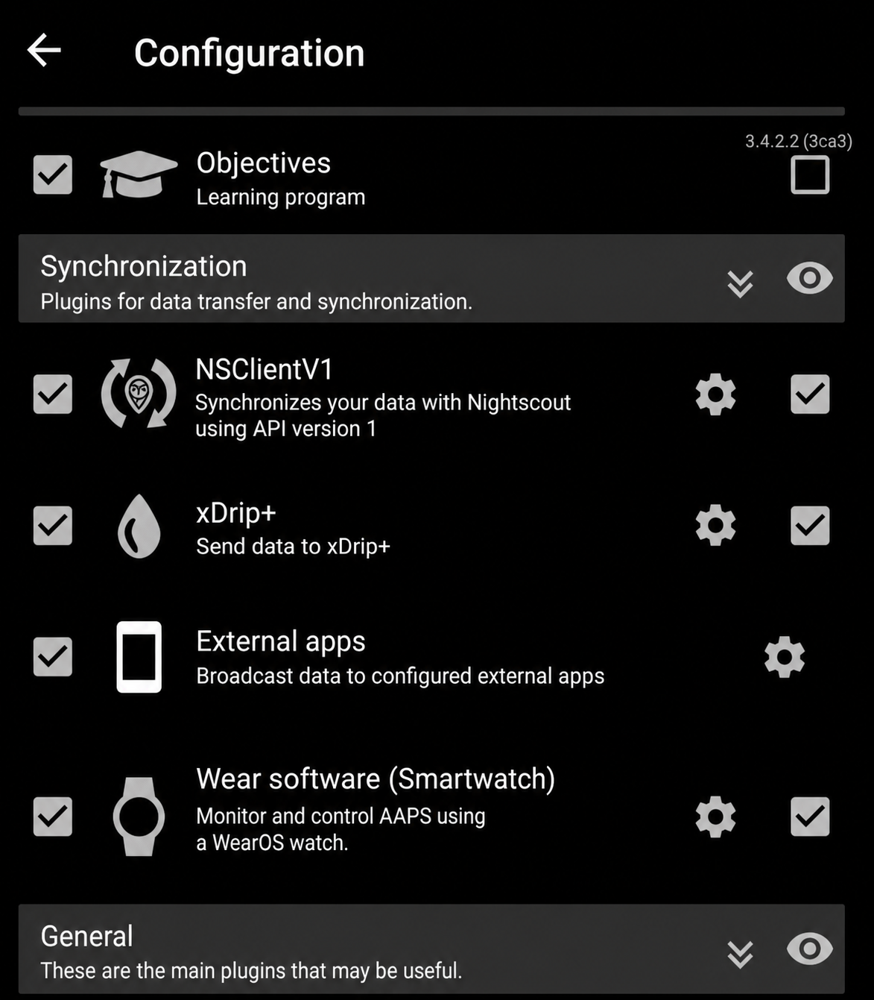
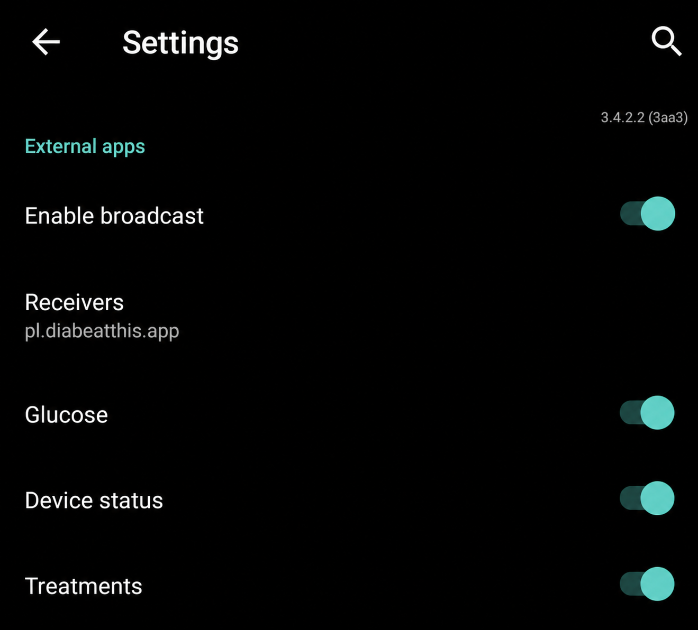

# Bezpośrednie połączenie z AAPS

## Cel i wymagania

Odbieranie glukozy, statusu urządzenia i zdarzeń leczenia bezpośrednio z AAPS.
Nightscout pozostaje alternatywnym źródłem danych.

Zgodnie z aktualną instrukcją projektu lokalna integracja wymaga wersji AAPS
ze zmianą obsługującą rozgłaszanie do aplikacji zewnętrznych. Nie zakładaj, że
każda wersja AAPS ma te opcje. Zmiana jest dostępna w
[gałęzi integracyjnej](https://github.com/njmo/AndroidAPS/tree/codex/external-broadcast-review).
Budowanie i aktualizowanie AAPS wykonuj według dokumentacji AAPS.

## Kroki

Po zainstalowaniu odpowiedniej wersji AAPS:

1. Otwórz AAPS i przejdź do **Configuration → Synchronization**.
2. Włącz **External apps**.
3. Otwórz ustawienia **External apps** i włącz rozgłaszanie.
4. Jako odbiorcę ustaw `pl.diabeatthis.app`.
5. Włącz **Glucose**, **Device status** i **Treatments**.
6. W DiaBeatThis wybierz **AAPS** jako źródło danych i zapisz ustawienia.

Nazwy opcji i poniższe zdjęcia dotyczą angielskiego interfejsu AAPS.

## Oczekiwany rezultat

DiaBeatThis otrzymuje aktualne odczyty. Porównaj czas i wartość pomiaru z AAPS.
Samo włączenie integracji nie oznacza podania insuliny ani potwierdzenia bolusa.

Jeśli nie widzisz opcji **External apps**, sprawdź wersję AAPS i zastosowaną zmianę.
Jeżeli dane się nie pojawiają, sprawdź odbiorcę i zaznaczone typy danych.
